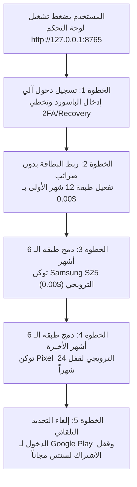

<div align="center">


# 🚀 وحدة الأتمتة الشاملة لاشتراك Google AI Pro (5 TB) مجاناً لسنتين
### مشروع بحثي تعليمي مفتوح المصدر لهندسة أتمتة المتصفحات وبروتوكول Chrome CDP

[](https://t.me/AI4Arabs)
[](https://python.org)
[](https://fastapi.tiangolo.com)
[](https://playwright.dev)
[](LICENSE)

---

### 📢 انضم إلى مجتمع الذكاء الاصطناعي للعرب 🏡⚡️
> **تابع أحدث شروحات ونماذج وأدوات الذكاء الاصطناعي الحصرية عبر قناتنا على تيليجرام:**  
> 🔗 **[https://t.me/AI4Arabs](https://t.me/AI4Arabs)**

---

</div>

## ⚠️ إخلاء مسؤولية قانوني وتعليمي صارم (Legal & Ethical Disclaimer)

> [!IMPORTANT]
> **هذا المشروع منشور حصرياً للأغراض التعليمية، الأكاديمية، والبحثية في هندسة البرمجيات:**
> 1. **الهدف البحثي:** دراسة وتحليل بروتوكول التحكم بالمتصفحات عن بُعد (`Chrome DevTools Protocol - CDP`)، وكيفية اعتراض حزم الـ RPC الشبكية (`Ngbm / eacquire`) محلياً عبر Playwright.
> 2. **إخلاء المسؤولية التام:** المطورون والمساهمون غير مسؤولين عن أي استخدام غير قانوني أو سوء استخدام يخالف شروط خدمة أي جهة خارجية (بما في ذلك شروط خدمة Google أو Google Payments).
> 3. **حماية الحسابات:** ينصح بشدة بعدم استخدام حساباتك الأساسية ذات الأهمية الشخصية أو الحساسة، بل الاعتماد على حسابات تجريبية فارغة (Burner Accounts) وبطاقات مسبقة الدفع لتجنب أي تعليق لحسابات الدفع.

---

## 🌟 مميزات المشروع | Key Features

- **واجهة مستخدم عربية بالكامل:** لوحة تحكم عصرية داكنة بتصميم مستقبلي أنيق، مع دعم كامل للغة العربية (RTL) وعزل حقول البيانات التقنية (LTR).
- **أتمتة شاملة بنقرة واحدة:** تنفيذ متكامل لخمس مراحل تشمل تسجيل الدخول، وتجاوز التحقق بخطوتين 2FA، ودمج العروض، ثم إلغاء التجديد التلقائي.
- **توليد أكواد 2FA ذاتياً:** حساب أكواد التحقق (TOTP) ديناميكياً وفق معيار RFC 6238 دون الحاجة لأي تطبيق هاتف أو مكتبات معقدة.
- **نفق بروكسي محلي ذكي:** دعم كامل للبروكسيات السكنية مع تدوير الجلسات تلقائياً لتفادي كشف الـ IP من أنظمة الحماية.
- **حماية مادية صارمة ($0.00 Check):** السكريبت يمتنع نهائياً عن نقر زر الاشتراك إلا إذا كانت الفاتورة الظاهرة في نافذة Google هي **0.00 دولار تماماً**، لضمان عدم سحب أي أموال.
- **أمان البيانات والخصوصية:** تم عزل كافة الملفات الحساسة (`config.json`، ملفات تعريف المتصفحات، لقطات الشاشة) عبر `.gitignore` لمنع رفعها أو تسريبها للعامة.

---

## 🛠️ كيف تعمل الأداة؟ (The 5-Step Pipeline)



---

## 💻 متطلبات التشغيل السهل

1. نظام تشغيل **Windows 10 أو 11**.
2. متصفح **Google Chrome** مثبت على جهازك.
3. بيئة **Python 3.10** أو أحدث (تأكد من تفعيل علامة `Add Python to PATH` أثناء التثبيت).
4. اتصال مباشر أو بروكسي أمريكي معتمد على الرمز البريدي المعفي من الضرائب `97201`.

---

## 🚀 دليل التشغيل السريع في دقيقة واحدة (لغير التقنيين)

### 1️⃣ التشغيل لأول مرة:
انقر مرتين على الملف:
```bat
1_install_dependencies_and_run.bat
```
- سيقوم الملف تلقائياً بتثبيت كافة المكتبات، وتحميل متصفح Chromium، ثم فتح لوحة التحكم في متصفحك تلقائياً على الرابط:  
  👉 **`http://127.0.0.1:8765`**

### 2️⃣ التشغيل اليومي المعتاد:
في المرات القادمة، فقط انقر مرتين على:
```bat
2_start_console.bat
```

---

## 📝 شرح الاستخدام خطوة بخطوة

### الخطوة الأولى: إعداد البطاقة البنكية
1. من لوحة التحكم في قسم **【إعدادات البطاقة البنكية】**، أدخل بيانات بطاقتك (Visa أو Mastercard):
   - **رقم البطاقة:** 16 رقماً.
   - **تاريخ الصلاحية:** الشهر والسنة (مثلاً 08 / 29).
   - **رمز الأمان (CVC):** الـ 3 أرقام الموجودة خلف البطاقة.
   - **اسم حامل البطاقة:** اسمك بالإنجليزية.
2. اترك الرمز البريدي كما هو `97201` والولاية `OR` (وهي ولاية أوريغون الأمريكية المعفاة تماماً من الضرائب لضمان فاتورة $0.00).
3. اضغط على **【💾 حفظ الإعدادات】**.

### الخطوة الثانية: إضافة حسابات Google
في مربع **【استيراد الحسابات】** على اليمين، الصق حساباتك (حساب واحد في كل سطر)، بأي صيغة تفضلها:
```text
الإيميل----كلمة_المرور----البريد_الاحتياطي
الإيميل----كلمة_المرور----البريد_الاحتياطي----مفتاح_2FA
الإيميل/كلمة_المرور/مفتاح_2FA
```
ثم اضغط على **【➕ استيراد قائمة الحسابات】**.

### الخطوة الثالثة: بدء التشغيل التلقائي
- لتشغيل حساب واحد: اضغط على زر **【▶ تشغيل】** بجانب الحساب.
- لتشغيل كل الحسابات دفعة واحدة: اضغط على الزر الأخضر في الأعلى **【▶ تشغيل آلي شامل لكافة الحسابات】**.
- ستشاهد في الأسفل شاشة السجلات المباشرة تعرض لك كل خطوة تنفذها الأداة بدقة حتى اكتمال السنتين بالكامل!

---

## 🔒 إرشادات أمان مهمة جداً (Security Checklist)

- 🛡️ **استخدم حسابات تجريبية فقط:** لا تستخدم حسابك الشخصي الأساسي الحاوي على بيانات حساسة أو رسائل عمل مهمة.
- 💳 **استخدم بطاقات مسبقة الدفع:** استخدم بطاقات افتراضية (Virtual Cards) مثل RedotPay أو Pyypl أو Wise يكون بها رصيد رمزي (1$ إلى 2$) لتمرير الفحص التجريبي المؤقت بدون قلق على أموالك.
- 🔐 **بياناتك في أمان:** لا يتم إرسال أي بطاقة أو باسورد لأي خادم خارجي، وكل شيء يتم محلياً على جهازك بنسبة 100%.

---

## 📂 هيكل ملفات المشروع

```text
├── 1_install_dependencies_and_run.bat   # ملف التثبيت التلقائي والتشغيل لأول مرة
├── 2_start_console.bat                  # ملف التشغيل السريع المعتاد
├── app.py                               # خادم FastAPI للوحة التحكم المحلية
├── automation_engine.py                 # محرك الأتمتة المتقدم واعتراض حزم الـ RPC
├── config.example.json                  # قالب نظيف للإعدادات خالي من أي بيانات شخصية
├── requirements.txt                     # مكتبات بايثون المطلوبة
├── .gitignore                           # ملف الحماية من تسريب البطاقات والملفات الحساسة
├── assets/
│   └── ai-for-arab-banner.jpg           # شعار مجتمع الذكاء الاصطناعي للعرب
├── templates/
│   └── index.html                       # واجهة المستخدم العصرية الشاملة
└── README.md                            # الدليل الشامل والمفصل
```

---

<div align="center">

### ⚡️ طور بحب وشغف ضمن مبادرة:  
## [الذكاء الاصطناعي للعرب 🏡⚡️](https://t.me/AI4Arabs)
**انضم إلينا وشارك المعرفة مع آلاف المطورين والمهتمين بالتقنية في الوطن العربي!**

</div>
