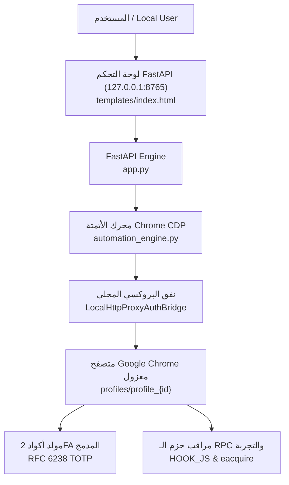

# 🚀 Google AI Pro Automation & CDP Engineering Console
> **An educational research project and browser automation framework utilizing Playwright, Chrome DevTools Protocol (CDP), and FastAPI.**

[](https://www.python.org/)
[](https://fastapi.tiangolo.com/)
[](LICENSE)
[-purple.svg)](#)

---

## ⚠️ Legal Disclaimer & Responsible Use Notice
### إخلاء مسؤولية قانوني وتعليمي صارم

> [!IMPORTANT]
> **FOR EDUCATIONAL, ACADEMIC, AND RESEARCH PURPOSES ONLY**  
> This repository is published strictly for technical research into **browser automation**, **Chrome DevTools Protocol (CDP)** orchestration, **client-side RPC payload inspection**, and **session proxy routing**.  
> - **No Warranty:** The software is provided "AS-IS", without warranties of any kind, express or implied.
> - **Compliance:** Users are solely responsible for ensuring their use of automation scripts complies with all applicable local laws, regulations, and third-party Terms of Service (including Google Terms of Service and Google Payments ToS).
> - **No Promotion of Abuse:** The authors and contributors do not condone, promote, or take responsibility for any unauthorized circumvention of billing systems, account suspensions, or misuse of promotional tokens.
> - **Experimental Research:** Cloud providers continuously patch and update promotional APIs and billing mechanisms; this tool serves as an architectural case study of modern web automation techniques.

---

## 📌 Project Overview | نبذة عن المشروع

This project provides a full-stack, local web console demonstrating advanced browser automation workflows. It bridges a modern **FastAPI** management server with **Playwright** via Chrome's remote debugging protocol (`--remote-debugging-port`), orchestrating multi-step authentication, proxy tunnels, and real-time state telemetry.

### Key Capabilities
- **Bilingual Interface (العربية / English):** RTL-first modern dark UI built for ease of use, with LTR-isolated credential fields.
- **CDP Session Isolation:** Each browser profile runs in its own sandboxed user directory (`--user-data-dir`) with WebRTC leak prevention.
- **RFC 6238 TOTP Engine:** Zero-dependency, pure Python HMAC-SHA1 calculation for two-factor authentication secrets.
- **Automated Proxy Tunnel Bridge:** Local HTTP proxy bridge supporting authentication rotation and residential IP endpoints.
- **Real-time Live Stream Log:** Real-time log capture and verification screenshots displayed directly in the web dashboard.

---

## 🛠️ Architecture & Workflow | آلية العمل



### The 5-Step Automation Pipeline
1. **Step 1 · Authentication & 2FA:** Automated credential entry, recovery email confirmation, and dynamic TOTP 2FA code generation.
2. **Step 2 · Layer 1 Subscription (12M):** Automated tax-exempt billing profile configuration and initial trial activation.
3. **Step 3 · Layer 2 Stacking (+6M):** Extended duration consolidation using device promotion tokens.
4. **Step 4 · Layer 3 Finalization (+6M):** Final 24-month duration stacking verified with zero-cost protection ($0.00).
5. **Step 5 · Auto-Cancel & Lock:** Automated navigation to Google Play Subscriptions to terminate auto-renewal, locking the multi-year expiration while preventing recurring charges.

---

## 💻 System Requirements | متطلبات التشغيل

- **Operating System:** Windows 10 or Windows 11 (64-bit).
- **Google Chrome:** Installed in standard default location.
- **Python:** Python 3.10 or newer (Ensure **"Add Python to PATH"** is checked during installation).
- **Network:** Direct US network or US-based residential proxy (required for US$0.00 tax-exempt Oregon 97201 billing).

---

## 🚀 Quick Start Guide | دليل التشغيل السريع

### 1. First Time Setup (التشغيل لأول مرة)
Double-click:
```bat
1_install_dependencies_and_run.bat
```
This batch script will automatically:
- Install required Python packages (`fastapi`, `uvicorn`, `playwright`, `pydantic`).
- Install Playwright's Chromium binaries.
- Launch the web server and open the console at `http://127.0.0.1:8765`.

### 2. Regular Daily Run (الاستخدام المعتاد)
Double-click:
```bat
2_start_console.bat
```

---

## 📋 Configuration & Usage | طريقة الإعداد والاستخدام

### 1. Payment Card Setup (إعداد بطاقة التحقق)
- In the left panel **【إعدادات البطاقة والمنطقة المعفاة】**, enter a valid card (Visa / Mastercard) that allows international online transactions.
- Keep the default tax-exempt postal code `97201` and state `OR` (Oregon).
- Click **【💾 حفظ الإعدادات】**.
> **Safety Guard:** The engine incorporates a strict $0.00 check; it will immediately abort execution if the checkout modal shows any charge greater than US$0.00.

### 2. Batch Account Import (استيراد الحسابات)
Paste accounts in the right panel (one per line). Any standard delimiter (`----`, `/`, `|`, space) is supported:
```text
email@gmail.com----Password----recovery@email.com
email@gmail.com----Password----recovery@email.com----2FA_SECRET
email@gmail.com----Password----2FA_SECRET
```
Click **【➕ استيراد قائمة الحسابات】**, then click **【▶ تشغيل】** to begin automation.

---

## 🔒 Security Best Practices | نصائح وإرشادات الأمان

1. **Use Burner / Research Accounts:** Do not use primary personal or enterprise Google accounts containing mission-critical data.
2. **Prepaid Virtual Cards:** Use virtual prepaid cards with minimal funds ($1 to $2) rather than primary debit/credit accounts.
3. **Data Protection (`.gitignore`):** Sensitive credentials, profiles, screenshots, and `config.json` are strictly git-ignored and never committed to version control.

---

## 📂 Project Structure | هيكل المشروع

```text
├── 1_install_dependencies_and_run.bat   # Automated dependency installer & launcher
├── 2_start_console.bat                  # Daily quick-start console launcher
├── app.py                               # FastAPI backend & web API server
├── automation_engine.py                 # Playwright CDP automation & RPC handler
├── config.example.json                  # Clean sanitized configuration template
├── requirements.txt                     # Python dependencies
├── .gitignore                           # Strict exclusion of cards, profiles & cache
├── templates/
│   └── index.html                       # Modern bilingual RTL/LTR dashboard
└── README.md                            # Documentation and architecture guide
```

---

## 📄 License
This project is released under the [MIT License](LICENSE).
